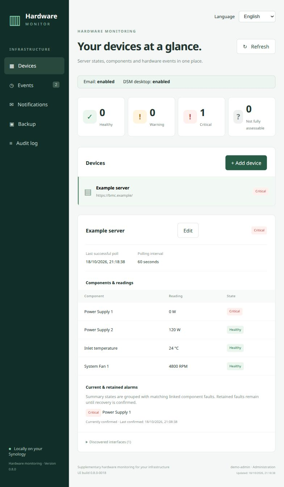
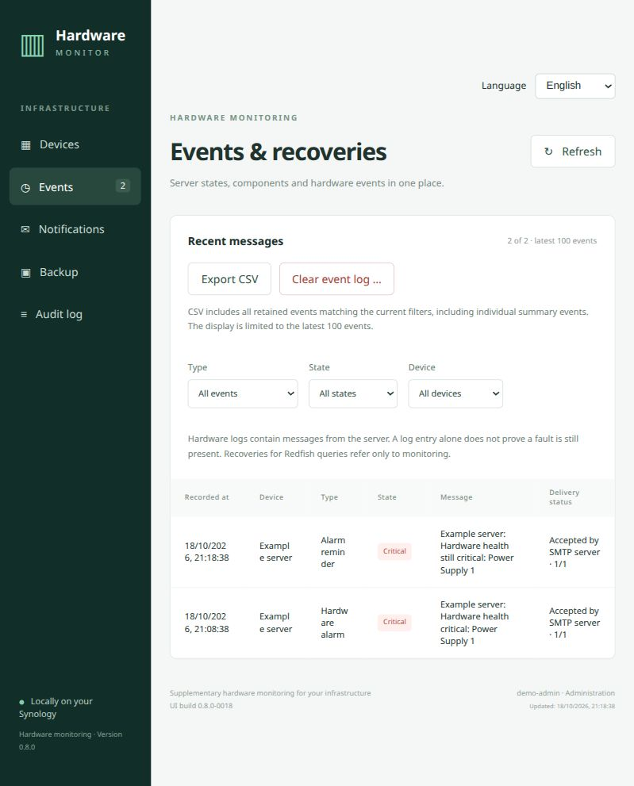

# Hardware Monitor for Synology

*This Synology package and code was developed by GPT-6.1 Sol and tested by humans.*

Open-source, cross-vendor server hardware monitoring on a Synology NAS using Redfish.

Due to thirdparty package limitations imposed by Synology, this package does not integrate natively into Synology notifications
and instead sends e-mails directly using SMTP, configured by you. DSM desktop notifications are available.
You can choose if you want either, none or both.

**Current build: 0.8.0-0025.** The Package Center title is **Hardware Monitor**.

## Features

- A lightweight Rust/Tokio background service, SQLite persistence and a Vue application inside the DSM 7 desktop. No Task Scheduler or loose polling scripts.
- Read-only Redfish polling with capability discovery, standard/selected OEM storage links, power supplies, fans, temperatures, hardware logs and reachability.
- Persistent faults, confirmed recoveries, optional reminders, deduplication and grouping of linked summary alarms without merging independent component faults.
- Independently configured SMTP email and native DSM desktop notifications, event filters and per-device delivery enablement. Editable templates, local timestamps and test actions.
- Filtered full-history CSV, audited event clearing and password-encrypted backup/restore, including device/SMTP credentials. Restore pauses monitoring/delivery and cancels old pending jobs.
- **German and English:** Automatic/Deutsch/English interface selection, separate saved languages for background channels, localized new event text/API messages/CSV headings and English documentation. Custom templates, vendor text and legacy event text are preserved.

## Compatibility and evidence

| Platform | Status |
|---|---|
| RS2421RP+ / v1000 / DSM 7.4.1-90080 | Prior-release installation, internal window, sign-in, device management, notification and backup/restore workflows confirmed by the user |
| DS220+ / geminilake / DSM 6.2.4 or DSM 7.x | Package profiles available; physical-model/DSM 6 acceptance pending |
| Dell R340 / iDRAC9 Enterprise | Read-only live discovery and selected fault/notification cases demonstrated |
| Dell iDRAC7+ and HPE ProLiant Gen10 / iLO 5 3.22 without Advanced | Intended scope; firmware/resource/license coverage still requires live acceptance |

The English additions from build 0017 and the grouped DSM 7 package from build 0018 need target acceptance. No universal RAID/OEM or production-reliability claim is made. **SNMP polling/traps are not implemented yet.** Full native DSM Application Privileges/viewer menu integration and operational hardening remain open. See [hardware compatibility](docs/HARDWARE-COMPATIBILITY.md), [validation](docs/VALIDATION.md) and [roadmap](docs/ROADMAP.md).

## Getting started

1. Download the checked SPK from the release tagged `latest`: `HardwareMonitor-dsm7-x86_64.spk` for DSM 7 (including v1000 and geminilake), or `HardwareMonitor-dsm6-geminilake.spk` for DSM 6.2 on DS220+. Verify it against `SHA256SUMS`, install through Package Center and open Hardware Monitor from DSM. The first release appears after this repository has been pushed to GitHub and its default-branch workflow succeeds.
2. Add an HTTPS management-controller origin and an account with the required hardware-read permissions. Use a trusted certificate chain/private CA with a matching hostname in Standard mode. For older Dell controllers, explicitly select iDRAC7/8 compatibility and import the exact server certificate from a trusted source; its fingerprint and validity dates are checked before HTTP credentials are sent.
3. Review current/retained alarms and discovered coverage. Missing or unavailable values do not confirm a healthy state or recovery.
4. If delivery is wanted, enable the device notification option, configure the channel and select events. Configure background languages independently of the interface. Existing templates are not overwritten by a language switch.
5. Download an encrypted app backup and retain its password separately. A restore replaces app data, then leaves devices/channels paused for deliberate review and reactivation.

Administrators manage/export/clear/restore; viewers are read-only. The backend checks native DSM identity/groups. Administrative operations additionally require HTTPS, matching origin, the DSM token and a session-bound package CSRF proof. Credentials are locally encrypted and are not returned to the browser.

## Screenshots

English interface, using synthetic example data; no real credentials or private device data are shown.





## Documentation

- [Architecture and trust boundaries](docs/ARCHITECTURE.md)
- [Device management](docs/DEVICE-MANAGEMENT.md)
- [Languages](docs/LANGUAGES.md)
- [Notification channels](docs/NOTIFICATIONS.md), [SMTP/templates](docs/SMTP.md), [DSM desktop notifications](docs/DESKTOP-NOTIFICATIONS.md)
- [Alarm grouping and multiple causes](docs/ALARM-GROUPING.md)
- [CSV, clearing and backup/restore](docs/BACKUP-RESTORE.md)
- [Development, local checks, SPK builds and GitHub releases](docs/DEVELOPMENT.md)
- [DSM package architecture families](docs/PACKAGE-ARCHITECTURES.md)
- [NAS acceptance](docs/NAS-ACCEPTANCE.md), [live R340 records](docs/LIVE-TEST-R340.md), [DSM privilege findings](docs/DSM-PRIVILEGES.md)
- [Validation](docs/VALIDATION.md), [roadmap](docs/ROADMAP.md)

Runtime state, passwords, tokens and raw private controller responses do not belong in source archives or fixtures.

## Development

```sh
cargo test --locked
cargo build --locked
npm ci --prefix web --ignore-scripts
npm run build --prefix web
node --test --test-isolation=none web/tests/*.test.mjs
python tools/integration_test.py target/debug/hardware-monitor
python tools/smtp_integration_test.py target/debug/hardware-monitor
```

Integration tests use synthetic loopback servers and OpenSSL-generated test certificates. They do not replace positive DSM/hardware acceptance. NAS packages require a statically linked musl build; do not copy a host-glibc binary into an SPK. Exact commands and toolchain boundaries are in [Development](docs/DEVELOPMENT.md).
